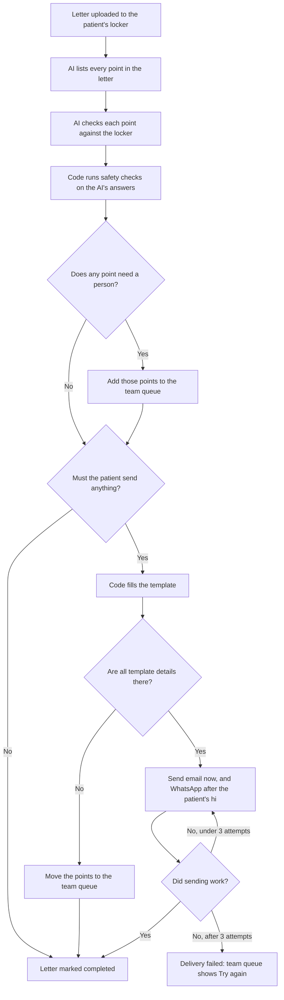

# CareFi Patient Locker and Auto Query Response

A portal that stores each patient's insurance documents and answers insurer query letters automatically. Drop in a letter, and the agent works out what the insurer wants, checks the patient's locker, and tells the patient only what's still missing, on email and WhatsApp.

- **Live app:** https://web-production-53814.up.railway.app

## How a letter moves through the system



Each point ends up as one of three decisions:

| Decision | What happens |
|---|---|
| Already in locker | Nothing is asked. The letter's page shows which document matched |
| Needed from patient | It goes into the message to the patient |
| Needs team | It goes to the team queue, and the patient isn't asked for it |

Steps only run when they're needed. If everything is already in the locker, no message goes out. If sending fails after 3 attempts, or the agent crashes, the letter appears in the team queue with **Try again**, and it carries on from its last saved step.

## Try it

Sample data is in [test-data/stage8](test-data/stage8), and every file in it is fake.

| Path | Use it for |
|---|---|
| `patients.csv` | Patients for the bulk import |
| `lockers/PAT-xxx/` | That patient's documents |
| `letters/PAT-xxx/` | That patient's query letters, each with an answer file showing the expected result |

1. Sign in as an admin and open **Import** on the patient list. Upload the CSV, then choose the `lockers` folder.
2. Open a patient. To receive the messages yourself, edit the patient and add your own email and phone number.
3. Drop a letter from the same patient's folder onto the **Query letters** tab. `L17-PAT-810-mixed-and-vague.pdf` is a good first one, because its answers cover all three decisions.
4. Open the letter to see each point, its decision and the reason. The message goes to the email address straight away.
5. Open **Team queue** to see the points that need a person.

**To get the WhatsApp message:** send `join road-depend` to +1 415 523 8886 on WhatsApp, then send `hi`. The email includes these steps too.

## Features

- **Locker:** upload PDF, JPG or PNG files. A repeat of a file is refused, and files open through links that expire in 5 minutes.
- **Document reading:** the AI reads each file once at upload and saves its type, summary, name and date. A name that doesn't match the patient gets a badge.
- **Team queue:** lists every point that needs a person, and every letter that failed or couldn't be delivered.
- **Bulk import:** bad rows and unmatched files are listed, and the rest still load.
- **Templates:** paste in new WhatsApp and email text, and the next message uses it.
- **Accounts and access:** there's no public signup. An agent sees only assigned patients, and a patient sees only their own locker.
- **Access log:** records who opened, uploaded or deleted what. Anything refused returns a 404 and is logged as `denied`.

## Tech stack

| Area | Choice |
|---|---|
| Repo | Turborepo and Bun |
| App | Next.js 16 |
| Agent | LangGraph.js, with progress saved in Postgres |
| AI | OpenAI Responses API with `gpt-4o-mini` |
| Database | PostgreSQL and Prisma 8 |
| Login | Better Auth |
| Files | Private S3-compatible bucket |
| Messages | Resend for email, Twilio sandbox for WhatsApp |
| Hosting | Railway |

The main code is in `apps/web/lib/agent` for the agent, `apps/web/lib/messaging` for sending, `apps/web/lib/access.ts` for access rules and `packages/db` for the database.

## Run it locally

You need Node 24 or newer, Bun 1.3.13 and a PostgreSQL database. You also need a bucket and keys for OpenAI and Resend.

```bash
bun install
cp apps/web/.env.example apps/web/.env
cp packages/db/.env.example packages/db/.env
# Fill in both .env files

bun run deploy:prepare   # Sets up the tables, the admin account and the templates
bun run dev              # http://localhost:3000
```

Sign in with the `ADMIN_EMAIL` and `ADMIN_PASSWORD` from `apps/web/.env`. To check for errors, run `bun run lint` and `bun run check-types`.

## Accuracy

The agent is scored on 18 fake letters with 41 points, and each answer was written before the first run.

| Check | Latest result |
|---|---|
| Points found | 41/41 |
| Decisions right | 38/41 and 39/41 across two runs |
| Extra points | 0 |

The prompts were tuned on these same letters, so a new letter may score lower. [results.md](test-data/stage8/results.md) lists every miss, what was fixed, what's still open and how to run the scoring.

## Known limits

- **WhatsApp isn't fully automatic on the live app.** Twilio's sandbox only allows free text as a reply, so the message waits until the patient sends `hi`. Sandbox membership lasts 72 hours. Setting `WHATSAPP_TOKEN` and `WHATSAPP_PHONE_NUMBER_ID` switches to the Meta Cloud API, which sends without waiting, but that path is off on the live app.
- **"Sent" can show while WhatsApp is still waiting.** A letter's "Sent" label means the email went and WhatsApp is ready.
- **A patient's new upload doesn't re-check the letter.** Uploading the letter again runs a new check.
- **Team alerts stay inside the portal.** The team sees them in the team queue, and no separate notification goes out.
- **Deleting a letter leaves its saved agent progress in the database.** That progress includes the patient's name and the message text.

The full list is in [API.md](API.md#12-known-limits).

## More docs

- [API.md](API.md): every route, who can access it, and what each part of the system does
- [SPEC.md](SPEC.md): the original build spec
- [.claude/specs](.claude/specs) and [.claude/plans](.claude/plans): the spec and plan for each build stage
